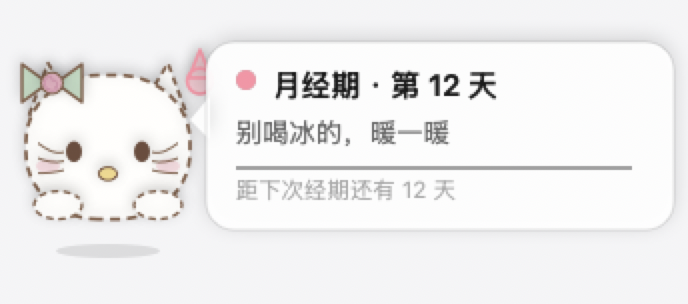
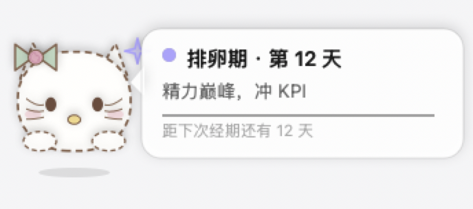
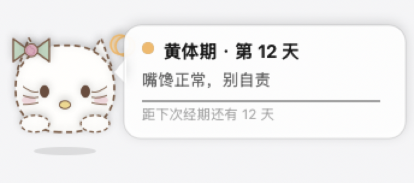

# 月伴 Yueban

> 一只住在 Mac 桌面上的小猫咪，帮你记生理期、看懂今天处于哪个激素期。

原生 macOS 桌面小宠物 + 便利贴。浮在所有窗口之上，不占 Dock，能随手拖走。
它会告诉你：**今天是什么期 · 一句话该注意什么 · 距下次还有几天**。

   

---

## 安装

### 方式一：一行命令（推荐）

```bash
curl -fsSL https://raw.githubusercontent.com/xingqiyi-97/yueban/main/install.sh | bash
```

脚本会自动下载最新版、装进「应用程序」、去掉隔离标记并启动。
如果你的 Mac 没有 Xcode 命令行工具，脚本会自动改为从源码编译。

### 方式二：手动下载

1. 到 [Releases](https://github.com/xingqiyi-97/yueban/releases) 下载 `Yueban-Mac.zip`
2. 解压，把 `月伴.app` 拖进「应用程序」
3. 首次打开：右键图标 → 「打开」→ 再点「打开」

> 提示「已损坏 / 无法打开」？在终端执行：
> ```bash
> xattr -dr com.apple.quarantine /Applications/月伴.app
> ```
> 这是没有苹果开发者签名的个人项目都会遇到的，不是文件坏了。

### 方式三：从源码编译

```bash
xcode-select --install     # 只需一次
git clone https://github.com/xingqiyi-97/yueban.git
cd yueban && ./build.sh    # 产出 月伴.app，通用二进制（Intel + Apple 芯片）
open 月伴.app
```

要求：macOS 11 以上。

---

## 怎么用

| 操作 | 效果 |
| --- | --- |
| **双击** 小猫 | 打开日历 |
| 日历里 **点日期** | 标记「这天来月经了」，再点取消 |
| **右键** 小猫 | 记录今天 / 打开日历 / 自定义形象 / 锁定位置 / 退出 |
| **拖动** 小猫 | 放到桌面任意位置（会记住） |
| 菜单栏水滴图标 | 打开日历 |

日历图例：实心粉圈 = 已记录，虚线粉圈 = 预测经期，紫点 = 预测排卵日。

### 激素期怎么判断

- 记录 **2 次以上** → 用你自己的平均周期（取最近 6 次）推算
- 不足 2 次 → 用预设的 28 天，可在日历底部修改
- 排卵日 = 下次经期前 14 天，排卵期取前后几天

每个期的颜色、气泡文案、小猫头顶的挂件都不一样：

| 期 | 颜色 | 挂件 | 提醒示例 |
| --- | --- | --- | --- |
| 月经期 | 粉 | 水滴 | 别喝冰的，暖一暖 |
| 卵泡期 | 绿 | 叶子 | 状态回升，开新坑 |
| 排卵期 | 紫 | 星星 | 精力巅峰，冲 KPI |
| 黄体期 | 橙 | 月亮 | 嘴馋正常，别自责 |

### 用照片自定义形象

右键 → **自定义形象…（用照片）** → 选一张照片，会自动抠出主体、加白色贴纸描边，变成你的专属桌宠。

- 全程在**本机**用 Vision 处理，图片不会上传任何服务器
- 需要 macOS 14 以上才有 AI 抠图；更老的系统会自动降级成圆形头像
- 右键 → **恢复默认形象** 可随时换回来


---

## 隐私

**所有数据只存在你自己的电脑里**，没有账号、没有服务器、没有埋点、不联网。

数据文件：`~/Library/Application Support/Yueban/data.json`（记录 + 设置）
自定义形象：`~/Library/Application Support/Yueban/avatar.png`

---

## 常见问题

**Q：窗口跑到屏幕外面找不到了？**
拔掉外接显示器后位置可能失效。新版会自动拉回主屏；不行就退出重开。

**Q：误拖动位置怎么办？**
右键 → 「锁定位置（防误拖）」。

**Q：预测不准？**
多记两三次就会准。它用的是你自己的历史平均，不是硬编码的 28 天。

**Q：能开机自启吗？**
目前没有。可以自己加：系统设置 → 通用 → 登录项 → 添加 `月伴.app`。

---

## 项目结构

```
main.swift          全部代码（数据模型 / 周期推算 / 桌宠绘制 / 日历 / 菜单栏）
Info.plist          App 配置
build.sh            本地构建（默认通用二进制）
install.sh          别人一键安装用的脚本
AppIcon.icns        应用图标
```

单文件 Swift + AppKit，没有第三方依赖。

---

## 说明与免责

- 本项目是个人兴趣作品，与三丽鸥（Sanrio）**没有任何关联**；默认形象为手绘风格的猫咪造型，仅作自用外观致敬，请勿用于商业用途，也欢迎用照片功能换成你自己的形象。
- 月伴提供的是**基于日历记录的周期推算**，不是医疗建议，不能用于避孕或疾病诊断。身体有异常请咨询医生。

---

## 许可

[MIT](LICENSE) — 随便用、随便改。
